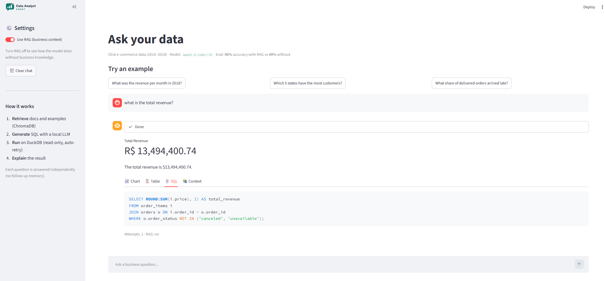
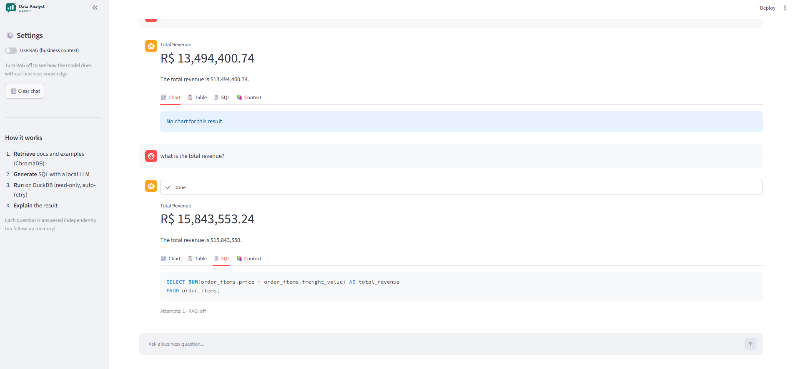
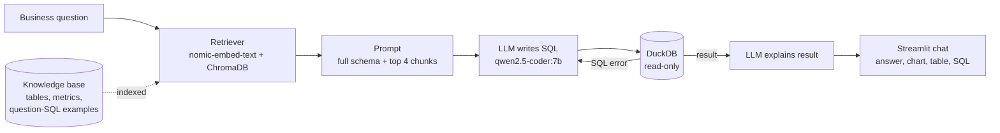
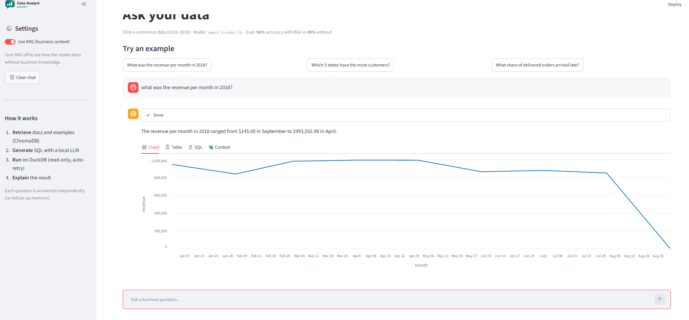

<p align="center">
  
</p>

<p align="center">
  Ask business questions in plain English. Get SQL, a result table, a chart and a short explanation.<br>
  Runs fully local with a 7B open-source model.
</p>

<p align="center">
  
</p>

---

## Why this project

Text-to-SQL models are good at SQL syntax but bad at business meaning. They don't know that
`customer_id` is created per order, that revenue should exclude canceled orders, or that joining
payments with order items double-counts money. These mistakes don't crash. They return a
believable wrong number.

This project tests one idea: **give the model the business knowledge it can't guess, and measure
how much that helps.**

## Results

Same model, same questions, same retry loop. The only difference is the retrieved context (RAG).

| Test set | Without RAG | With RAG |
|---|---|---|
| Main set, first run (20 questions) | 45% | 95% |
| Holdout set, never used for tuning (5 questions) | 20% | 100% |
| **Combined (25 questions)** | **40%** | **96%** |

Metric: execution accuracy. The agent's result is compared with the result of a verified gold
query, ignoring row order and column names, with a 1% tolerance on numbers.

After one round of error analysis on the main set (fixing how `order_item_id` is described in the
knowledge base), the main set reached 100%. I report the first-run and holdout numbers as the
headline, because the main set was used for that fix.

**What failed without RAG:** almost every failure was a silent wrong answer, not an error. The
model counted `customer_id` instead of unique customers, invented a revenue formula
(`price * freight_value`), joined `sellers` to `orders` through a column that doesn't exist, and
averaged a sequence number as if it were a count.

| RAG on | RAG off |
|---|---|
|  |  |

## How it works



1. **Retrieve.** The question is embedded and the 4 most similar knowledge chunks are pulled from
   ChromaDB: table docs, metric definitions and example question-SQL pairs.
2. **Generate.** The prompt contains the full schema plus the retrieved context. The model returns
   one SQL query in a code block, which is parsed out of its answer.
3. **Run.** DuckDB runs the query on a read-only connection. If it fails, the error message goes
   back to the model for up to 2 retries.
4. **Explain.** The first 20 rows plus the total row count go to the model, which writes a short
   plain-language answer using only numbers from the result.



## Design decisions

- **Full schema always, retrieval for business knowledge.** The schema is small (8 tables), so it
  always goes into the prompt. Retrieval is used for what doesn't fit and needs relevance: metric
  definitions, data quirks and examples. In an early test, retrieval alone never returned the
  `order_items` table for revenue questions, because the doc didn't use the user's words.
- **Chunk by meaning, not by size.** One chunk per table, per metric and per example question.
  Each chunk is self-contained, so retrieval returns exactly what's needed.
- **Asymmetric embeddings.** Documents are embedded with `search_document:` and questions with
  `search_query:`, as `nomic-embed-text` was trained.
- **Business definitions are written down, not guessed.** Revenue = `SUM(order_items.price)`,
  excluding canceled and unavailable orders. Customers = `COUNT(DISTINCT customer_unique_id)`.
  Late = delivered after the estimated date. Average delay = days late, averaged over late orders
  only.
- **Retries fix syntax, context fixes meaning.** Without RAG, the model wrote the same broken join
  three times, even with the error message. The error said what was wrong, not how to fix it.
- **Guardrails.** Read-only database connection, a system prompt that allows only SELECT and WITH,
  a bounded retry loop, and narrow exception handling (`duckdb.Error` only).
- **Fair comparison.** The baseline is the identical pipeline with retrieval switched off.
  `temperature=0` makes runs reproducible, so the baseline scored exactly 45% on both runs.

## Limitations

- **Small benchmark.** 25 questions, so one question is 4%. Treat the numbers as strong evidence,
  not a precise rate.
- **Author bias.** I wrote the knowledge base and the test questions. Real users ask messier
  questions, so 96% is an optimistic estimate.
- **No follow-up memory.** Each question is answered on its own, so "and in 2017?" doesn't work.
- **Ambiguous questions.** Terms that aren't defined in the knowledge base (for example "delay"
  before I added a definition) get the model's own interpretation.
- **Partial periods.** The data ends in early September 2018, so the last month looks like a drop.

## Next steps

- Query rewriting, so follow-up questions become standalone questions
- A test set written by people who never saw the knowledge base
- Have the agent state its interpretation of ambiguous terms in the answer
- Compare with a larger model and with retrieved schema for bigger databases
- A lockfile (`uv` or `pip-tools`) for full reproducibility across platforms

## Run it locally

**Requirements:** Python 3.10, [Ollama](https://ollama.com), about 6 GB free disk space.

```bash
# 1. Models
ollama pull qwen2.5-coder:7b
ollama pull nomic-embed-text

# 2. Environment
python -m venv .venv
.venv\Scripts\activate          # Windows
# source .venv/bin/activate     # Mac/Linux
python -m pip install -r requirements.txt
```

3. Download the [Olist Brazilian E-Commerce dataset](https://www.kaggle.com/datasets/olistbr/brazilian-ecommerce)
   from Kaggle and unzip the CSV files into `data/`.

```bash
# 4. Build the database and the vector index
python src/db.py
python src/retriever.py

# 5. Start the app
streamlit run src/app.py

# Optional: run the evaluation (takes 5-15 minutes)
python src/evaluate.py
python src/evaluate.py holdout
```

## Project structure

```
src/
  db.py            load CSVs into DuckDB, read the schema
  retriever.py     chunk the knowledge base, embed, index, search
  agent.py         prompt, SQL generation, retry loop, explanation
  evaluate.py      RAG vs no-RAG evaluation
  app.py           Streamlit UI
knowledge/
  tables/          one doc per table: grain, keys, quirks
  metrics/         business definitions with SQL patterns
  examples/        question-SQL pairs
eval/
  questions.md     20 test questions with gold SQL
  holdout.md       5 held-out questions
  results*.csv     per-question results
tests/             unit tests that run in CI (no LLM needed)
```

## Tech stack

Python · Ollama (qwen2.5-coder:7b, nomic-embed-text) · ChromaDB · DuckDB · pandas · Streamlit ·
Altair · pytest · Ruff · GitHub Actions

---

Built by [Zerihun Waje](https://www.linkedin.com/in/waje) as a hands-on project in AI engineering.
